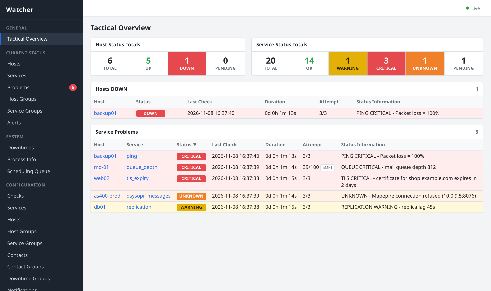
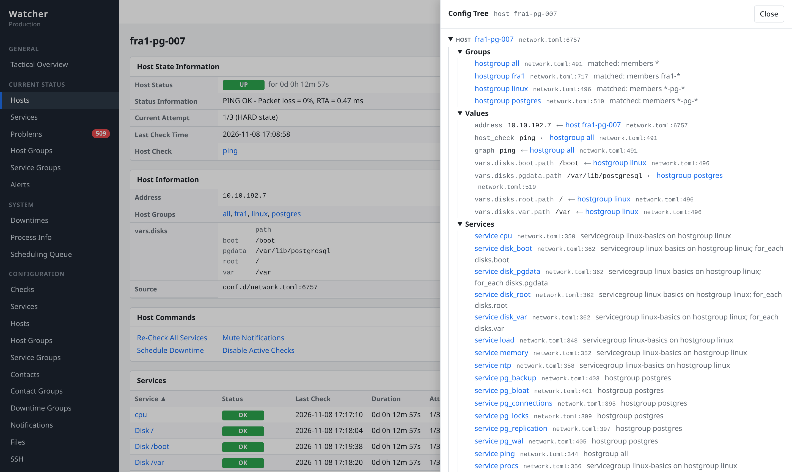
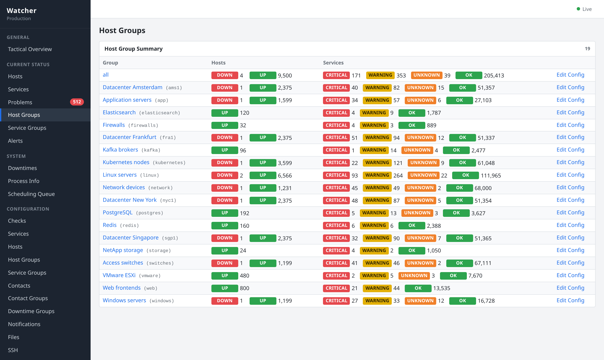

<h1 align="center">Watcher</h1>

<p align="center">
  <b>Infrastructure monitoring that is as easy to set up as it should be,<br>
  and always tells you why it does what it does.</b>
</p>

<p align="center">
  <a href="https://github.com/mergedeyes/watcher/actions/workflows/ci.yml"></a>
  <a href="LICENSE"></a>
  
</p>

<p align="center">
  <a href="#getting-started">Getting started</a> ·
  <a href="docs/README.md">Documentation</a> ·
  <a href="docs/introduction.md#what-works-today">What works today</a> ·
  <a href="https://github.com/mergedeyes/watcher/issues">Issues</a>
</p>

<p align="center">
  <picture>
    <source media="(prefers-color-scheme: dark)" srcset="docs/images/overview-dark.png">
    
  </picture>
  <br>
  <sub>A simulated network: 9,500 hosts and 206,000 services in four datacenters.</sub>
</p>

Watcher checks your servers, network devices and applications, keeps
their metrics, and alerts you when something breaks. It is a single
program with a web UI built in: no agents to roll out and no add-ons to
assemble. The check plugins you already run with Nagios work as they
are.

If you have ever asked "why is this host checked every minute?", "where
does this threshold come from?" or "why did nobody get paged?", Watcher
was built for you. Every setting can be traced to the file and line that
set it, and every alert to the rule that sent it.

## Why Watcher

- **Nothing is a mystery.** The Config Tree shows every value of a host
  or service and where it comes from: which file, which line, which
  group. In the web UI and on the command line.
- **Describe your network once.** Put hosts into groups by name pattern
  and give each group its services. A new web server gets its checks
  the moment it is added, and one service can cover every disk, website
  or queue on a host.
- **Edit in the browser or in your editor, both at once.** The web UI
  changes the same text files you keep in Git, keeps your comments, and
  shows exactly what will change before it applies. Edits in your
  editor are live within a second.
- **Alerts without surprises.** Problems are confirmed before anyone is
  woken up, flapping services are held back, and notification rules
  don't depend on their order: every matching rule notifies, and nobody
  gets the same message twice. Open problems come back as reminders
  and escalate to the next person until someone acknowledges them, and
  every notification is logged, so you can see who was told and when.
  When a router dies, dependencies keep the alerts about everything
  behind it quiet.
- **No agents.** Watcher runs checks on remote machines over SSH, copies
  its scripts there by itself, keeps passwords and keys encrypted, and
  pins host keys.
- **Your data stays yours.** Metrics and history go into PostgreSQL
  (with TimescaleDB if you like), with plain SQL views for Grafana, BI
  tools or your own queries.
- **Up in minutes.** One binary and a setup wizard in the browser or the
  terminal. A database is optional to start with.
- **Ready for large networks.** Lists are filtered, sorted and paged on
  the server and update live, so the web UI stays fast with hundreds of
  thousands of services.

<p align="center">
  <picture>
    <source media="(prefers-color-scheme: dark)" srcset="docs/images/config-tree-dark.png">
    
  </picture>
</p>

## Features

- **Checks:** Nagios plugins, your own scripts (Nagios output,
  `key=value` or JSON), results pushed over the API, thresholds with
  units, built-in ping, TCP, HTTP, DNS and TLS certificate checks.
- **Remote checks over SSH** with encrypted secrets, pinned host keys and
  automatic script copies.
- **Alerting:** SOFT and HARD states with retries, host UP/DOWN, flap
  detection; email, webhooks, Slack, Microsoft Teams, Telegram, ntfy,
  Gotify, PagerDuty, Jira and scripts; reminders, escalations,
  dependencies and time periods (business hours, on-call at night).
- **Operations:** acknowledgements, one-off and recurring downtimes,
  muting, re-checks from a right-click menu.
- **Web UI:** tactical overview, problems, host and service groups, alert
  history, graphs, configuration forms and a file editor that checks as
  you type.
- **Data:** PostgreSQL or TimescaleDB, SQL views, read-only database
  logins, copies to a central database.
- **API:** everything the web UI does, with tokens for your scripts.

<p align="center">
  <picture>
    <source media="(prefers-color-scheme: dark)" srcset="docs/images/host-groups-dark.png">
    
  </picture>
</p>

## Status

Watcher is in early development. A single instance monitors your
network today; see [what works today](docs/introduction.md#what-works-today).

Coming next: remote nodes reporting to a central hub, repairing data in
graphs, and native checks for IBM i, AIX, HMC and MQ.

## Getting started

There are no prebuilt releases yet. Build Watcher from source (Rust and
Node.js), then start the setup wizard:

```sh
git clone https://github.com/mergedeyes/watcher && cd watcher
npm --prefix web ci && npm --prefix web run build
cargo build --release
mkdir ~/watcher && cd ~/watcher
/path/to/watcher/target/release/watcher setup    # open the URL it prints
```

[Installation](docs/install.md) covers PostgreSQL, HTTPS and running
Watcher as a service. [First steps](docs/guides/first-steps.md) takes you
from an empty setup to your first monitored host.

## Documentation

- [Introduction](docs/introduction.md): what Watcher is and how it works
- [Installation](docs/install.md)
- [First steps](docs/guides/first-steps.md)
- [How the configuration works](docs/guides/configuration.md)
- [All guides and references](docs/README.md)

## Contributing

Bug reports, ideas and pull requests are welcome. Please
[open an issue](https://github.com/mergedeyes/watcher/issues) first for
larger changes, so we can talk about the approach.

## License

Watcher is free software under the [GNU AGPL-3.0](LICENSE). Check
plugins and scripts run as separate programs, so they can have any
license.
