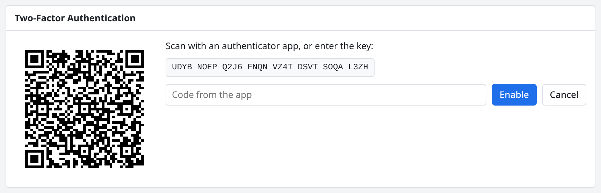

# Web UI

The web UI is built into the `watcher` binary; there is nothing extra to
install. By default it listens on http://127.0.0.1:8080. Change this with
`listen` in [watcher.toml](../reference/watcher-toml.md).

## Login

With a database, everyone has to log in. Create accounts on the command
line:

```sh
watcher user add alice              # asks for the password
watcher user add admin --admin      # admins may edit the configuration
watcher user passwd alice           # set a new password
```

Admins can also manage accounts in the web UI under Settings → Users.
Everyone can change their own password under Account, and turn on
[two-factor authentication](#two-factor-authentication) there.

After five failed logins, the username is locked for a minute. A session
lasts 14 days after it was last used.

Without a database there are no accounts and no login. The web UI then only
listens on the local machine (loopback). `watcher run --no-auth` turns the
login off even with a database, also only on loopback.

## Two-factor authentication

With two-factor authentication, the login asks for a code after the
password. The code comes from an authenticator app on your phone, such as
Google Authenticator, Microsoft Authenticator, Aegis or 1Password. It has
six digits and changes every 30 seconds; this kind of code is called TOTP
(time-based one-time password). Someone who learns your password still
can't log in without your phone.

Each user turns it on for their own account. The setup wizard (in the
browser, or `watcher init`) offers it for the first admin as well.

1. Open Settings → Account and click **Set Up** under Two-Factor
   Authentication.
2. Scan the QR code with the app. If you can't scan it, type the key next
   to it into the app instead.
3. Enter the code the app shows, and click **Enable**.
4. Save the ten recovery codes that appear. They are shown only once.

<p align="center">
  <picture>
    <source media="(prefers-color-scheme: dark)" srcset="../images/two-factor-dark.png">
    
  </picture>
  <br>
  <sub>Setting up two-factor authentication on the Account page.</sub>
</p>

From then on, you log in with your password first and then with the
current code from the app. Each code works only once: to log in again
right away, for example in a second browser, wait for the next code.

**Recovery codes** stand in for the app when you don't have your phone.
Type one into the code field at the login. Each recovery code works once.
Under Account, **New Recovery Codes** replaces all of them, and **Turn
Off** switches two-factor authentication off again. Both need a code from
the app or a recovery code, so that someone who finds your browser logged
in can't turn it off.

**Lost your phone and your recovery codes?** An admin turns two-factor
authentication off for you under Settings → Users → **Reset 2FA**, or on
the server:

```sh
watcher user totp-off alice
```

Then log in with your password alone, and set it up again.

Good to know:

- It needs a `watcher.toml`. The app secrets are stored encrypted in the
  database, with the key file `data_dir/secret.key` (the same file that
  encrypts [SSH secrets](ssh.md#secrets)). **Back it up together with the
  database**: without it, users with two-factor authentication can't log
  in until an admin turns it off with `watcher user totp-off`.
- The clock of the server must be right (use NTP). Codes from 30 seconds
  before or after are accepted too, for phones whose clock is a little
  off.
- Wrong codes count like wrong passwords: after five failed attempts, the
  username is locked for a minute.
- [API tokens](#api-tokens) don't need a code: scripts keep working with
  their token alone.

## Pages

| Page | Shows |
|---|---|
| Tactical Overview | Hosts that are DOWN, service problems, totals. |
| Hosts | All hosts with their state and their services per state, with totals. Search by name, address or host group. |
| Host | One host: its services, commands, graphs, alert history and notifications. |
| Services | All services, with totals. Filter by state, or search by host, service or output. |
| Service | One service: state, output, commands, metrics with thresholds, graphs, alert history and notifications. |
| Problems | Hosts that are DOWN and all services that are not OK. |
| Host Groups, Service Groups | Status totals per group. |
| Alerts | The alert history, filtered by host, type, state, SOFT/HARD and time range. |
| Downtimes | Schedule and end downtimes; acknowledged, muted and disabled services. |
| Nodes | On a hub: which [nodes](nodes.md) are connected; add, join again and remove nodes (admins). |
| Process Info | Running time and results per minute; switches for notifications and active checks. |
| Scheduling Queue | When each service is checked next. |
| Configuration | Forms and a file editor for the configuration (admins). |
| Account | Your user, password, two-factor authentication and API tokens. |
| Users | Add, disable and delete accounts, set passwords and admin rights, reset two-factor authentication (admins). |

Status totals are links to the filtered lists. On a group's list
(`/hosts?group=linux`), the totals count only that group. Click a column
header to sort. Names sort by their numbers, so `web2` comes before
`web10`.

Long lists are split into pages. The bar under a list shows which rows
you see, and has buttons for the first, previous, next and last page.
Choose how many rows a page has (50 to 500); your browser remembers it.
Searching, filtering or sorting goes back to the first page.

The number on Problems counts unhandled problems: those not
acknowledged and not in a downtime.

**Commands:** right-click a host or service row, or use the Commands panel
on its page: Re-Check Now, Acknowledge Problem, Schedule Downtime, Mute
Notifications, Disable Active Checks, Submit Result (passive services
only), and the matching undo commands. Hosts and services show badges
for them: ACK, DOWNTIME, MUTED, CHECKS OFF. See [Operations](operations.md).

**Live / Paused** in the top bar: pages update live. New results change
the rows you see right away. When a state changes, the list is loaded
again, so services move into or out of it. Paused keeps the page still;
Refresh loads it once.

**Graphs** show the last 15 minutes by default, with ranges down to 30
seconds. Drag to zoom in, double-click to reset. The host page shows the
host's `graph` service, or the host check, and you can pick another one.
`graphs = false` on a check or service turns its graphs off.

## Configuration

Admins can edit the configuration in the web UI. The menu has Checks,
Services, Hosts, Host Groups, Service Groups, Contacts, Contact Groups,
Downtime Groups, Time Periods, Notifications, Dependencies and Files.

The web UI edits the same TOML files you edit by hand:

- New objects are written to `conf.d/ui/` (`checks.toml`, `services.toml`,
  `hosts.toml`, `groups.toml`, `contacts.toml`, `notify.toml`,
  `dependencies.toml`).
- Changes to existing objects are written to the file where the object is,
  and comments and formatting are kept.
- Objects written as inline arrays in a file can't be edited in the forms;
  use the file editor for them.

How the forms work:

- Lists show the file and line of every object.
- Forms show the known fields. Other keys in the file are kept as they
  are. Clearing a field removes the key from the file.
- Text fields suggest values (objects, scripts, vars, metrics, durations),
  but you can type anything.
- The host form covers host groups, services, service groups, changes to
  assigned services, and services only this host has.
- A service runs either a check or a command of its own: while one is
  set, the other field is greyed out. A check runs either a command or a
  built-in check, in the same way.
- Configuration → Checks also lists the [built-in checks](../objects/check.md#built-in-checks).
  When a form's check is a built-in one, an **Options** section shows each
  of its options with what it does, its default and whether it is
  required (`*`). Values a check already sets show as `(from check …)`.
  Settings that only commands have (Shell, Run On, Copy, Passive) are
  greyed out then.
- Group membership shows on both sides. The host form lists the host
  groups that list the host (`Also: dc1 · pattern web*`), and the host
  group form lists the hosts that list the group. The same goes for service
  and contact groups. Removing one with × takes effect when you save.
  Deleting an object also removes it from those lists.
- Selectors, host group members and downtime groups show what they match
  right now: `3 hosts: web01 (name web*), …`. Errors, for example in an
  `expr`, show as you type.
- The **Config Tree** shows where the object and each of its values come
  from, and where the object is used. Each entry links to its form or file
  line.

**Saving:** Save shows a preview of what will change (+ added, ~ changed,
− removed) and any problems. Nothing is written until you click Apply.

**Clone** opens a new form filled from an object. You can create several at
once: `web03, web[04-10]` creates 8 clones in the original's file. Cloned
hosts get their address from their name.

**Edit Config** on the status pages opens the right form: for a host the
host form or its host groups, for a service the service, the host's change
of it, or the check, for a group the group form.

**Files** lists the config files and has an editor that validates as you
type. It marks errors at the line and summarizes what would change.

**Conflicts:** if a file changed on disk after you opened it, the editor
shows the differences. You can revert single chunks, use the version on
disk, or keep yours.

**Someone else is editing:** a form or file that someone else has open is
read-only, with a note saying who is editing it, where (web UI, `watcher
config edit`, vim, ...) and since when. When they are done, the page
reloads the file and you can edit. **Edit Anyway** takes the file over
right away; the other person's page turns read-only within half a minute.
The Files list shows who is editing each file. See
[Editing at the same time](configuration.md#editing-at-the-same-time).

## Config mode

`config_mode` in `watcher.toml` decides whether the web UI or the files are
in charge:

| Mode | Web UI | Files |
|---|---|---|
| `hybrid` (default) | can edit | watched; changes load within a second |
| `files` | read-only | watched |
| `ui` | can edit | not watched; reload with `SIGHUP` |

A configuration with errors is never applied. The running configuration
stays, and the log and the web UI show why.

## API tokens

Scripts and passive checks log in with an API token. Create one under
Account → API Tokens → Create token, or with
`watcher token create <user> <name>`. The token is shown only once. Send it
as `Authorization: Bearer wt_...`. A token has the same rights as its user.

## Development

```sh
npm --prefix web run dev       # forwards /api to 127.0.0.1:8080
```

Debug builds read the UI from `web/build` on disk; release builds have it
built in.
